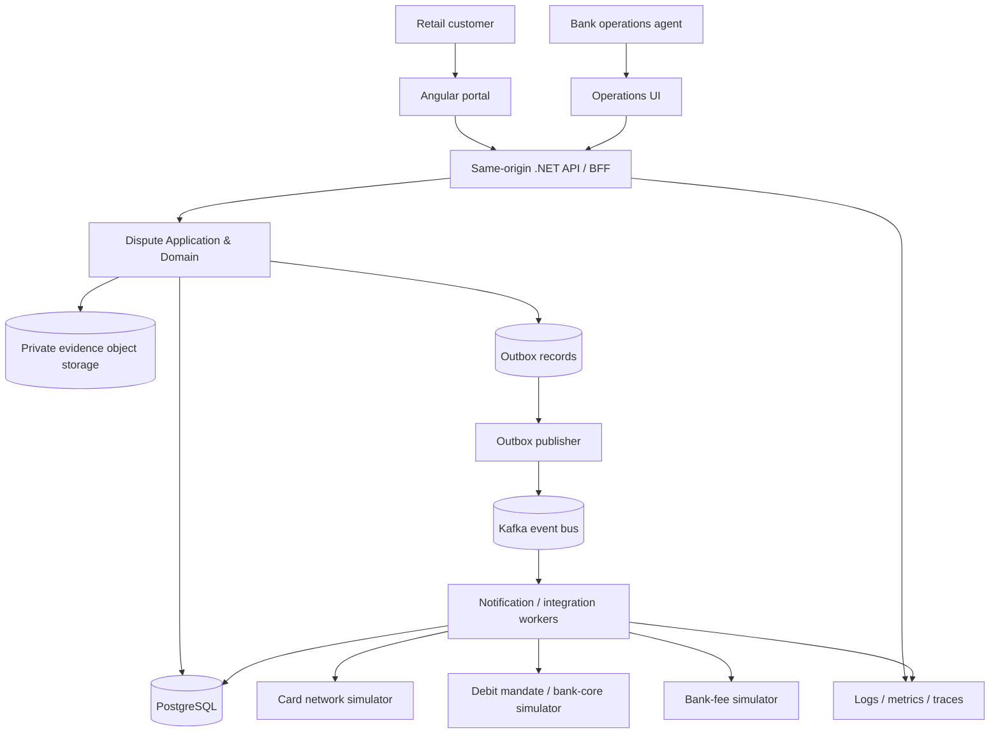

# 02 | Logical architecture, bounded contexts and dispute workflows

## Context and drivers

**People:** Retail customer, bank dispute operations specialist, auditor, support engineer.  
**Customer journey:** Browse own posted transactions → select dispute reason → upload evidence if required → submit once → receive case ID → track status → view outcome and money movement independently.  
**Quality attributes:** Secure, recoverable, trustworthy, observable, maintainable, accessible, affordable to operate, and scalable in measured increments.

## C4-style deployment-neutral context



## Core bounded modules and aggregate boundaries

- **Transactions:** read-only mock transaction catalog, posted vs pending eligibility, masked account/card references; transaction ownership supplied by trusted identity and backend ownership query.
- **Dispute Cases:** `DisputeCase` aggregate owns state transitions, reason, policy version, decision, optimistic version and identifiers. Customer-facing state is not ledger state.
- **Policies:** `ICardDisputePolicy`, `IDebitOrderDisputePolicy`, `IBankChargeDisputePolicy`; clock, feature flags and policy version injected. Policies produce an `EligibilityDecision` with reason and required evidence, not `bool` alone.
- **Chargebacks:** card-network submission, processor reference, representment, pre-arbitration/appeal (deferred), deadlines and decision. No pretend immediate merchant refund.
- **Debit orders:** mandate type (`EftDebit`, `RegisteredMandate`, `DebiCheck`); date-based applicability; authorisation facts; threshold-based *internal* review tier; reversal request and bank-core reconciliation.
- **Bank charges:** internal fee justification and adjustment decision; no network chargeback.
- **Evidence:** object storage metadata and access grants; content never embedded in Kafka messages, URLs or logs.
- **Timeline/Audit:** immutable user-visible event history distinct from security audit log; actor and reason; corrections recorded as new events, not deleted history.
- **Processing:** integration adapters, outbox/inbox, retries, dead-letter recovery, reconciliation.

## Domain entities / value objects

`DisputeCase`: `id`, `customerId`, `transactionId`, `type`, `reason`, `description`, `status`, `policyVersion`, `version`, `createdAt`, `updatedAt`, `resolvedAt?`.  
`CaseTimelineEvent`: `eventId`, `caseId`, `sequence`, `status`, `actorType`, `reasonCode`, `occurredAt`, `recordedAt`, `correlationId` (immutable).  
`Chargeback`: `caseId`, `schemeCaseReference`, `schemeReasonCode`, `submissionDeadline?`, `representmentDeadline?`, `outcome`, `version`.  
`DebitOrderMandate`: `mandateReference?`, `collectionType`, `authorised`, `mandateMatched`, `verificationSource`, `verifiedAt?`.  
`FinancialOperation`: `id`, `caseId`, `operationType`, `externalReference`, `amountMinorUnits`, `currency`, `operationStatus`, `attempts`, `lastCheckedAt?`.

Value objects: `Money` (ISO currency + minor units), `DisputeId`, `TransactionId`, `IdempotencyKey`, `PolicyDecision`, `CustomerIdentity`, `ProcessingDeadline`. Dates stored as UTC instants, with South African local date calculated explicitly for rules.

## Workflow A: card purchase and chargeback

1. `Submitted` → ownership, posting, window, duplicate and reason eligibility verified.
2. `UnderReview` → issuer decides if evidence or internal remedy is appropriate.
3. `ChargebackInitiationPending` → durable external operation created with unique reference.
4. `ChargebackInitiated` → network accepts claim with an authoritative reference; not equal to funds settled.
5. `MerchantReview` → acquirer / merchant processor receives it.
6. On acceptance: `MerchantAccepted` → `FinancialSettlementPending` → `FundsConfirmed` → `ResolvedCustomerFavoured` → `Closed`.
7. On dispute: `RepresentmentReceived` → `IssuerReview` → `ResolvedCustomerFavoured` or `ResolvedMerchantFavoured`; any subsequent financial movement must still be reconciled.
8. On invalid, expired or unsupported request: `Ineligible` with reason and customer notification; complaints/escalations separate.

Card scheme timelines and legal rights must be verified against scheme rules and bank agreements; do not embed one generic 120-day scheme rule.

### Implemented local slice: PR-09

The production/network design above remains proposed. The executable PR-09 slice is a SQLite-backed,
Development/Testing-only card simulator, not a Visa/Mastercard integration:

```text
Initiated -> MerchantReview -> MerchantAccepted -> explicit settlement -> Closed
                           -> MerchantContested -> RepresentmentReceived -> IssuerReview
                                                                         -> Approve -> explicit settlement -> Closed
                                                                         -> Reject -> Closed
```

`Chargeback` owns the card transition guards, stable mock reference, original complaint reason and
synthetic representment metadata. Application orchestration rechecks ownership and card eligibility
on initiation; Infrastructure implements the pure `ICardNetworkGateway` and SQLite persistence.
The existing dispute retains independent case, decision and financial statuses. Merchant contest
is not final rejection; acceptance/issuer approval is not confirmation. `RequestSettlement` records
intent, while `ExecuteSettlement` consumes an explicit simulated result. Failures and timeout/unknown
outcomes are durable and block retries/closure; they never imply credit.

Every simulated action commits chargeback state, dispute state, immutable customer timeline and a
separate immutable audit record in one writer-serialized SQLite transaction. Audit records contain
the trusted synthetic actor ID, correlation ID, command, outcome, statuses and evidence metadata.
Unique per-command operation references prevent repeat effects. The mock is safe inside this
transaction **only because it has no external effects**; network intent/outbox, external idempotency,
authoritative settlement and recovery must be implemented before replacing it.

The sole processing route is `POST /api/v1/disputes/{id}/chargeback-simulations`; it is absent outside
Development/Testing and requires authentication plus a separate server-configured card simulation
key. Customer GET responses expose explicit safe DTOs, never EF entities, audit identities or secrets.
Evidence is metadata only (nonempty GUID, allow-listed kind, server timestamp), not uploaded or
verified documents. Real operations authorization, evidence storage, arbitration and Kafka are not
part of this slice. See [the implemented workflow and rollback guide](../../README.md#pr-09-card-chargeback-and-representment-simulation)
and the generated Development OpenAPI for current contracts.

## Workflow B: debit order

1. Identify `EftDebit`, `RegisteredMandate` or `DebiCheck`, amount, original collection date and customer.
2. Select the **effective-dated policy version**; avoid applying the post-April-2026 rule indiscriminately to historic cases.
3. For ordinary eligible EFT/RM disputes under the April-2026 regime: calculate day 1 from the next day, through day 60 inclusive, using an explicit date library and bank calendar policy.
4. For DebiCheck: verify mandate and collection compliance. A valid, authorised, matching collection is normally not disputable; unauthorised or mismatched facts require a dedicated investigation path.
5. Assign *internal review tier*: ≤ R2,000 = standard; > R2,000 = enhanced (illustrative, configurable; **not** a legal threshold). Amount must not exclude the customer's ability to raise a complaint.
6. Persist `ReversalRequested`; call bank-core adapter only through idempotent operation reference; if response unknown, `ReversalOutcomeUnknown` and reconcile before retrying.
7. Mark `Reversed` only after authoritative posting confirmation. Otherwise `ReviewRequired`, `DeclinedWithReason`, or `OutOfWindowQueryReferral`.

## Workflow C: bank charges

Open → internally verify fee schedule and account activity → request evidence if needed → approve adjustment or decline with reason → if approved, post adjustment through bank-core adapter → reconcile ledger → close and notify.

## Universal case lifecycle (customer view)

`Submitted → Under Review → Additional Information Needed (optional) → Processing → Decision Issued → Financial Adjustment Pending (if applicable) → Completed / Closed`.

The UX shows separate fields `caseStatus` and `financialStatus`: **no funds promised until confirmed**. The timeline is immutable and customer-friendly; internal events can contain more detail than the public projection.

## Critical invariants

- Only the authenticated owner or explicitly authorized bank agent may access a case.
- A transaction may have at most one *active* case for the same allowed dispute scope; reopening is a separate controlled action.
- A case cannot skip required policy, evidence, authorisation or reconciliation gates.
- No event may claim a confirmed financial reversal solely because an HTTP request returned 200.
- Duplicate callbacks and messages cannot execute the same financial side effect twice.
- Every state change records actor, reason, timestamp, version and outbox intent atomically.

## Naming and component discipline

Prefer explicit `CreateDisputeCaseHandler`, `DisputeEligibilityService`, `ICardSchemeGateway`, `IDebitOrderMandateVerifier` and `ICustomerContext` over generic `Helper`, `Manager` and `ServiceBase`. Keep controllers thin. Encapsulate invariants in aggregate methods; avoid public setters and interfaces with unrelated methods.
